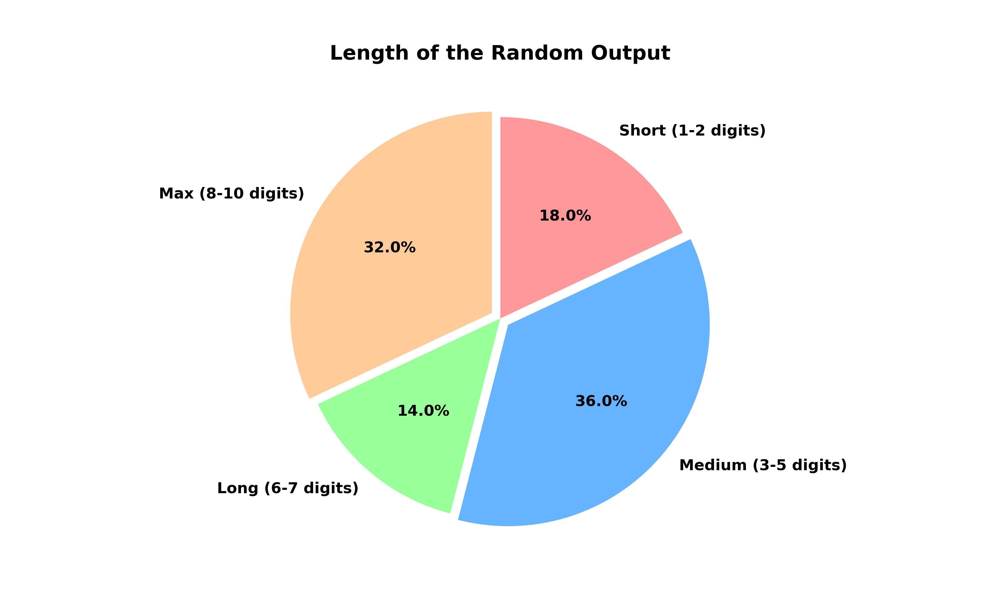

# Custom MacLaren-Marsaglia Generator

An experimental of a custom pseudo-random number generator based on the MacLaren-Marsaglia method. It combines hardware-level OS entropy with a deterministic Linear Congruential Generator.

## Structure

*   `next_lcg(current_seed)`: Advances the state and generates the next number using LCG.
*   `get_system_entropy()`: Reads 4 random bytes from the host OS and converts them into a 32-bit.
*   `main()`: Initializes the 100-element entropy pool, runs the dynamic obfuscation cycle, and prints the results.

# Output

The generator successfully outputs varying lengths on the fly, introducing high unpredictability:

*   **Short (1-2 digits):** `1`, `3`, `56`
*   **Medium (3-5 digits):** `570`, `7539`, `84597`
*   **Long (6-7 digits):** `6837504`, `9524047`
*   **Max / Full 32-bit (8-10 digits):** `382552170`, `4116782380`

## Output Analysis

## Limitations

1.  **Not for Production Cryptography.** This is an experimental and should not be used in production-grade cryptographic systems.
2.  **Local Environment Security.** The script relies on the host environment's security. If the system memory or local state is compromised by malware, the internal seed pool can be leaked.
